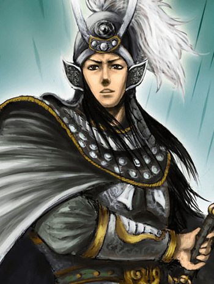
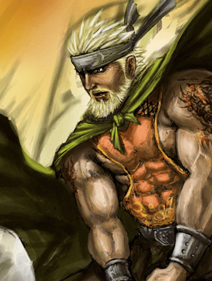

# 2008 标准武将技能（示例）

技能原文 + 一句白话，按本项目“2008版标准包”整理。

| 武将 | 技能说明 |
| :---: | :--- |
|  **周瑜** 吴 · 3 点体力 | **英姿** **原文：** 摸牌阶段，你可以多摸一张牌。 **一句话：** 轮到你摸牌时，可以多摸一张，通常就是摸三张。  **反间** **原文：** 出牌阶段限一次。你可以令一名角色选择一种花色，然后其获得你的一张手牌。若其以此法选择的花色与其得到的牌花色不同，则你对其造成1点伤害。 **一句话：** 每个出牌阶段一次，让别人先猜一种花色，再抽走你一张手牌，猜错就受到1点伤害，牌仍归他。 |
|  **黄盖** 吴 · 4 点体力 | **苦肉** **原文：** 出牌阶段，你可以失去1点体力，然后摸两张牌。 **一句话：** 出牌时可以反复用，每次自己先掉1点体力，再摸两张牌。 |

来源：[本项目标准包定义、技能说明与实现](../character/standard.js)；图片使用项目内对应武将立绘。
