# 2008 标准武将技能

共 25 名武将、40 个技能；沿用小图配技能说明的布局，每个技能附一句白话解释。

[魏（7 名）](#魏) · [蜀（7 名）](#蜀) · [吴（8 名）](#吴) · [群（3 名）](#群)

## 魏

| 武将 | 技能说明 |
| :---: | :--- |
| 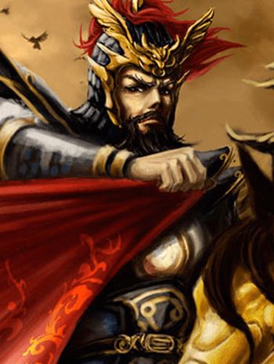 **曹操** 魏 · 4 点体力 | **奸雄** **原文：** 当你受到伤害后，你可以获得对你造成伤害的牌。 **一句话：** 挨打后，可以把造成这次伤害的牌拿到自己手里，比如别人用来打伤你的【杀】。  **护驾** **原文：** 主公技，当你需要使用或打出一张【闪】时，你可以令其他魏势力角色选择是否打出一张【闪】。若有角色响应，则你视为使用或打出了一张【闪】。 **一句话：** 你当主公时，需要【闪】可以请其他魏势力角色替你出，是否帮忙由他们决定。 |
|  **司马懿** 魏 · 3 点体力 | **反馈** **原文：** 当你受到伤害后，你可以获得伤害来源的一张牌。 **一句话：** 挨打后，可以从打你的人那里拿走一张手牌或装备牌。  **鬼才** **原文：** 一名角色的判定牌生效前，你可以打出一张手牌代替之。 **一句话：** 任何人做判定时，你可以出一张手牌换掉判定牌，让结果按你出的牌算。 |
| 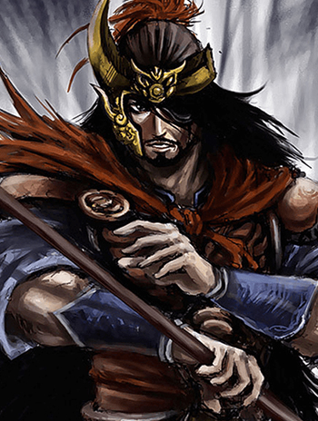 **夏侯惇** 魏 · 4 点体力 | **刚烈** **原文：** 当你受到伤害后，你可以判定。若结果不为红桃，则伤害来源须弃置两张手牌，否则其受到来自你的1点伤害。 **一句话：** 挨打后可以翻牌判定，只要不是红桃，打你的人就得弃两张手牌，否则被你反打1点伤害。 |
| 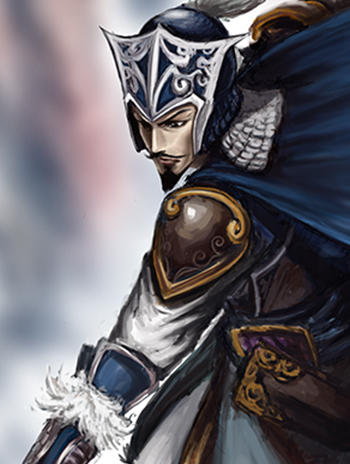 **张辽** 魏 · 4 点体力 | **突袭** **原文：** 摸牌阶段，你可以改为获得至多两名其他角色的各一张手牌。 **一句话：** 摸牌时可以不从牌堆摸，改从最多两名其他角色手里各拿一张牌。 |
| 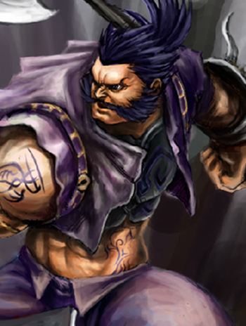 **许褚** 魏 · 4 点体力 | **裸衣** **原文：** 摸牌阶段，你可以少摸一张牌。若如此做，当你本回合内使用【杀】或【决斗】造成伤害时，此伤害+1。 **一句话：** 摸牌时少摸一张，本回合你用【杀】或【决斗】造成的伤害就能多1点。 |
| 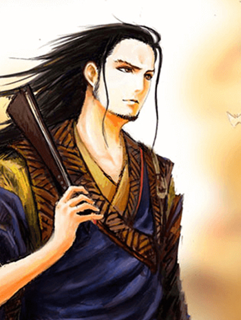 **郭嘉** 魏 · 3 点体力 | **天妒** **原文：** 当你的判定牌生效后，你可以获得之。 **一句话：** 你的判定结算后，可以把那张判定牌收入手牌。  **遗计** **原文：** 当你受到1点伤害后，你可以观看牌堆顶的两张牌，然后将其分配给任意角色。 **一句话：** 每受到1点伤害，就可以看牌堆顶的两张牌，再把它们任意分给自己或别人。 |
| 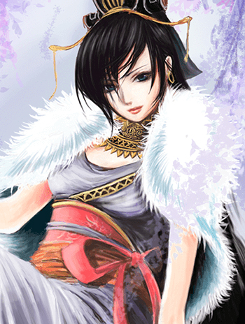 **甄宓** 魏 · 3 点体力 | **洛神** **原文：** 准备阶段，你可以判定。若结果为黑色，你获得判定牌。你可重复此流程，直到出现红色的判定结果。 **一句话：** 准备阶段可以连续翻牌判定，黑色的收入手牌，翻到红色就停，也可以提前收手。  **倾国** **原文：** 你可以将一张黑色手牌当做【闪】使用或打出。 **一句话：** 手里的黑色牌都可以当【闪】用。 |

## 蜀

| 武将 | 技能说明 |
| :---: | :--- |
| 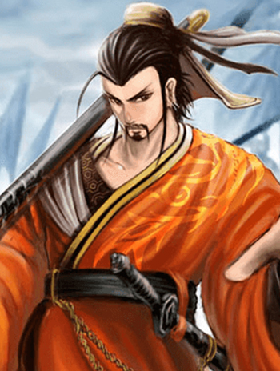 **刘备** 蜀 · 4 点体力 | **仁德** **原文：** 出牌阶段，你可以将任意张手牌交给其他角色。当你以此法于一回合内给出第二张牌时，你回复1点体力。 **一句话：** 出牌时可以把手牌送给别人，这回合累计送出第二张时回1点体力，之后继续送也不会再回血。  **激将** **原文：** 主公技，当你需要使用或打出【杀】时，你可以令其他蜀势力角色依次选择是否打出一张【杀】。若有角色响应，则你视为使用或打出了此【杀】。 **一句话：** 你当主公时，需要【杀】可以请其他蜀势力角色替你出，有人愿意出就算你出了。 |
| 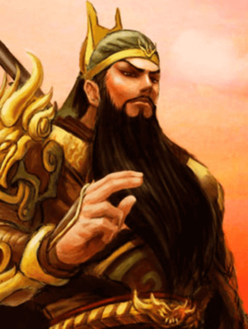 **关羽** 蜀 · 4 点体力 | **武圣** **原文：** 你可以将一张红色牌当做【杀】使用或打出。 **一句话：** 红色的手牌或装备牌，都可以当【杀】使用或打出。 |
| 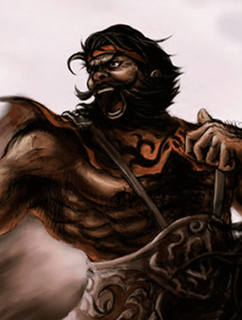 **张飞** 蜀 · 4 点体力 | **咆哮** **原文：** 锁定技，出牌阶段，你使用【杀】没有数量限制。 **一句话：** 你在出牌阶段用【杀】不限次数，但距离和目标等条件仍要满足。 |
| 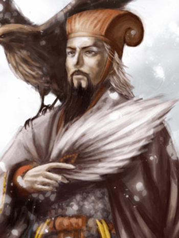 **诸葛亮** 蜀 · 3 点体力 | **观星** **原文：** 准备阶段，你可以观看牌堆顶的X张牌，并将其以任意顺序置于牌堆顶或牌堆底。（X为存活角色数且至多为5） **一句话：** 准备阶段看与存活人数相同、最多5张的牌，自己决定它们的顺序和放在牌堆顶还是底。  **空城** **原文：** 锁定技，当你没有手牌时，你不能成为【杀】或【决斗】的目标。 **一句话：** 只要你没有手牌，别人就不能指定你为【杀】或【决斗】的目标。 |
| 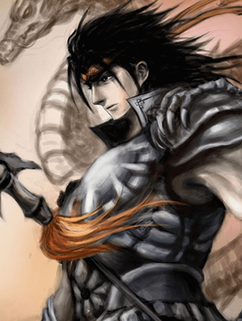 **赵云** 蜀 · 4 点体力 | **龙胆** **原文：** 你可以将【杀】当做【闪】，或将【闪】当做【杀】使用或打出。 **一句话：** 手里的【杀】可以当【闪】，手里的【闪】也可以当【杀】。 |
| 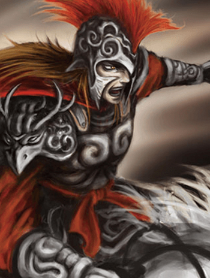 **马超** 蜀 · 4 点体力 | **马术** **原文：** 锁定技，你计算与其他角色的距离时-1。 **一句话：** 你到其他人的距离自动减1，更容易够到目标。  **铁骑** **原文：** 当你使用【杀】指定目标后，你可以进行判定。若结果为红色，则此【杀】不可被闪避。 **一句话：** 出【杀】指定目标后可以翻牌判定，翻到红色，这个目标就不能用【闪】躲这张【杀】。 |
|  **黄月英** 蜀 · 3 点体力 | **集智** **原文：** 当你使用普通锦囊牌时，你可以摸一张牌。 **一句话：** 每用一张【过河拆桥】这类普通锦囊，就可以摸一张牌。  **奇才** **原文：** 锁定技，你使用锦囊牌无距离限制。 **一句话：** 用锦囊时不受距离限制，例如【顺手牵羊】也能对远处的人用。 |

## 吴

| 武将 | 技能说明 |
| :---: | :--- |
|  **孙权** 吴 · 4 点体力 | **制衡** **原文：** 出牌阶段限一次，你可以弃置任意张牌，然后摸等量的牌。 **一句话：** 每个出牌阶段一次，弃掉几张手牌或装备牌，就重新摸几张。  **救援** **原文：** 主公技，锁定技，其他吴势力角色对你使用的【桃】的回复值+1。 **一句话：** 你当主公时，其他吴势力角色用一张【桃】救你，能让你回复2点体力。 |
|  **甘宁** 吴 · 4 点体力 | **奇袭** **原文：** 你可以将一张黑色牌当做【过河拆桥】使用。 **一句话：** 黑色的手牌或装备牌可以当【过河拆桥】，用来拆别人一张手牌、装备牌或判定区的牌。 |
|  **吕蒙** 吴 · 4 点体力 | **克己** **原文：** 弃牌阶段开始时，若你于本回合的出牌阶段内没有使用或打出过【杀】，则你可以跳过此阶段。 **一句话：** 出牌阶段没有用过【杀】，连【决斗】里打出的【杀】也没有，就可以跳过弃牌。 |
| 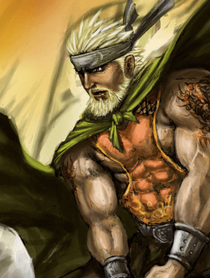 **黄盖** 吴 · 4 点体力 | **苦肉** **原文：** 出牌阶段，你可以失去1点体力，然后摸两张牌。 **一句话：** 出牌时可以反复用，每次自己先掉1点体力，再摸两张牌。 |
| 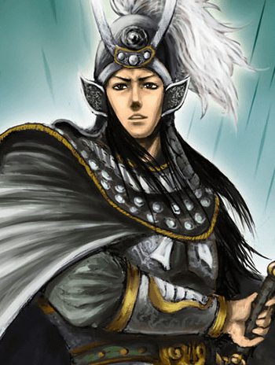 **周瑜** 吴 · 3 点体力 | **英姿** **原文：** 摸牌阶段，你可以多摸一张牌。 **一句话：** 轮到你摸牌时，可以多摸一张，通常就是摸三张。  **反间** **原文：** 出牌阶段限一次。你可以令一名角色选择一种花色，然后其获得你的一张手牌。若其以此法选择的花色与其得到的牌花色不同，则你对其造成1点伤害。 **一句话：** 每个出牌阶段一次，让别人先猜一种花色，再抽走你一张手牌，猜错就受到1点伤害，牌仍归他。 |
| 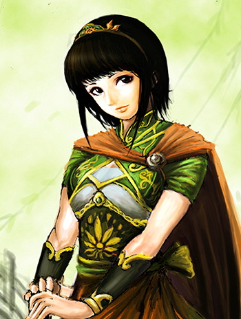 **大乔** 吴 · 3 点体力 | **国色** **原文：** 你可以将一张方片牌当做【乐不思蜀】使用。 **一句话：** 方片牌可以当【乐不思蜀】用，给别人挂上后，他若判定不是红桃，就跳过出牌阶段。  **流离** **原文：** 当你成为【杀】的目标时，你可以弃置一张牌并将此【杀】转移给攻击范围内的一名其他角色（不能是此【杀】的使用者）。 **一句话：** 别人用【杀】打你时，可以弃一张手牌或装备牌，把这张【杀】转给你攻击范围内的另一人，但不能转回出杀者。 |
| 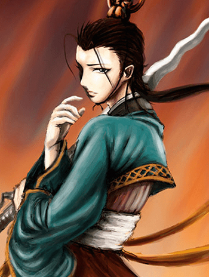 **陆逊** 吴 · 3 点体力 | **谦逊** **原文：** 锁定技，你不能成为【顺手牵羊】和【乐不思蜀】的目标。 **一句话：** 别人不能把你选为【顺手牵羊】或【乐不思蜀】的目标。  **连营** **原文：** 当你失去最后的手牌时，你可以摸一张牌。 **一句话：** 手牌一旦全没了，可以马上摸一张，出掉、弃掉或被拿走都算。 |
| 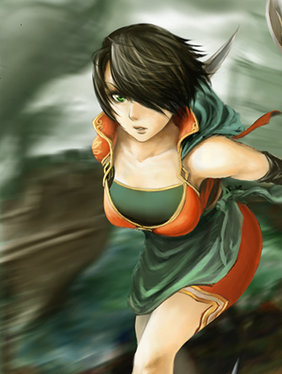 **孙尚香** 吴 · 3 点体力 | **枭姬** **原文：** 当你失去一张装备区内的牌后，你可以摸两张牌。 **一句话：** 装备区每失去一张牌，就可以摸两张，换装备、被拆或被别人拿走都算。  **结姻** **原文：** 出牌阶段限一次，你可以弃置两张手牌并选择一名已经受伤的男性角色。你与其各回复1点体力。 **一句话：** 每个出牌阶段一次，弃两张手牌，找一个受伤的男性角色，你和他各回1点体力。 |

## 群

| 武将 | 技能说明 |
| :---: | :--- |
| 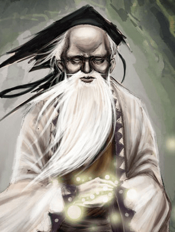 **华佗** 群 · 3 点体力 | **青囊** **原文：** 出牌阶段限一次，你可以弃置一张手牌并令一名角色回复1点体力。 **一句话：** 每个出牌阶段一次，弃一张手牌，就能给受伤的自己或别人回1点体力。  **急救** **原文：** 你的回合外，你可以将一张红色牌当做【桃】使用。 **一句话：** 你的回合外，红色的手牌或装备牌都可以当【桃】，用来救濒死的人。 |
| 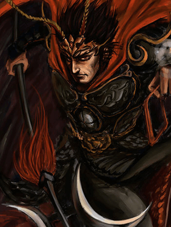 **吕布** 群 · 4 点体力 | **无双** **原文：** 锁定技，①当你使用【杀】指定一名角色为目标后，其需使用两张【闪】才能抵消；②当你使用【决斗】指定其他角色为目标后，或成为其他角色使用【决斗】的目标后，其每次响应需打出两张【杀】。 **一句话：** 别人要出两张【闪】才能躲你的【杀】，和你【决斗】时每次接招也得出两张【杀】。 |
|  **貂蝉** 群 · 3 点体力 | **离间** **原文：** 出牌阶段限一次，你可以弃置一张牌，视为一名男性角色对另一名男性角色使用一张【决斗】（不可被【无懈可击】响应）。 **一句话：** 每个出牌阶段一次，弃一张手牌或装备牌，让一名男性对另一名男性发起【决斗】，而且这次决斗不能被【无懈可击】取消。  **闭月** **原文：** 结束阶段，你可以摸一张牌。 **一句话：** 结束阶段可以额外摸一张牌。 |

## 常见用语

- **判定：** 翻开牌堆顶一张牌，按这张牌的花色、颜色等决定结果。
- **锁定技：** 满足条件就自动生效，不能选择不发动。
- **主公技：** 在通常的身份局里，只有担任主公时才能使用或生效的技能。
- **普通锦囊：** 使用后当场结算的锦囊，如【过河拆桥】；【乐不思蜀】属于延时锦囊。
- **失去体力：** 也会掉血，但不算受到伤害，不会触发“受到伤害后”的技能。

来源：[本项目“2008版标准包”名单、武将属性与技能说明](../character/standard.js)；图片使用项目内对应武将立绘。
